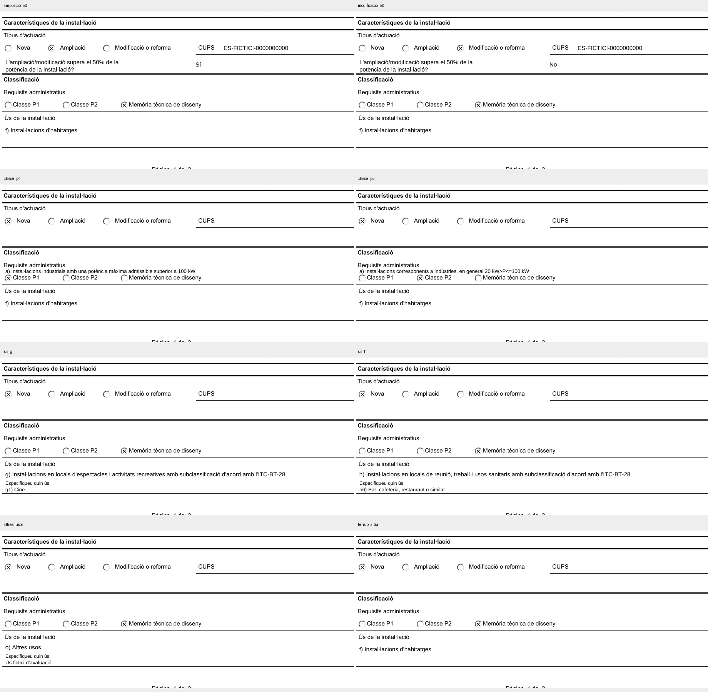

# CIE estático: pruebas del 16/10/2026

> Estado posterior: [cierre técnico del 16/10/2026](fase-0-cierre.md). Las limitaciones y cifras siguientes conservan el diagnóstico anterior a las correcciones de flujo.

Se ha implementado y probado la escritura sobre la conversión estática aportada por el usuario. La selección de variantes se resuelve en el generador, sin ejecutar XFA ni depender de PDFCraft o de un servicio externo. Los PDF son muestras ficticias sin firma.

**Estado: fase 0 abierta.** La escritura y conservación de la base estática pasan las pruebas. Falta acreditar que las posiciones propuestas de los campos condicionales coincidan con la distribución del original al desplegarlos. No se ha dado por superada esa comprobación ni se ha iniciado la fase 1.

## Pruebas ejecutadas

| Prueba | Resultado | Evidencia |
|---|---|---|
| Pruebas unitarias BRIE y CIE | 40 superadas, 0 fallidas | [TAP](../evidence/phase-0/unit-tests.tap) |
| CIE base con datos ficticios | 62 operaciones de escritura en dos páginas | [PDF](../output/pdf/phase-0/CIE-datos-ficticios-PRUEBA.pdf) y [operaciones](../evidence/phase-0/cie-static-base-placement.json) |
| Ocho ramas condicionales | 8/8 transfieren los valores seleccionados | [Generación](../evidence/phase-0/cie-static-generation.json) |
| Opciones P1, P2, g y h | Las 62 opciones se generan completas sin abreviar ni recortar | Prueba específica en TAP |
| Combinación de ampliación, P1, uso g y otra tensión | Superada | Prueba específica en TAP |
| Reapertura independiente de los diez PDF con pypdf | Texto esperado presente; dos páginas; sin AcroForm ni widgets | [Verificación](../evidence/phase-0/cie-static-verification.json) |
| Comparación de las veinte páginas con la base estática | 0 píxeles modificados fuera de las zonas de relleno, margen de 2 píxeles | Misma verificación |
| Borrador incompleto | Conserva los vacíos y señala las tres respuestas condicionales ausentes | [Operaciones y avisos](../evidence/phase-0/cie-static-incomplet-placement.json) |
| Texto excesivo, ramas incompatibles, tipos y opciones incorrectos | Rechazados expresamente; sin recorte ni sustitución silenciosa | TAP |
| Mapa respecto a inventario XFA | 74 entradas mapeadas; dos contadores y firma excluidos del relleno | TAP y [mapa](../tools/pdf-phase0/cie-layout.json) |
| Protección de los originales | Referencia oficial preservada y archivos de entrada sin modificaciones por el generador | TAP y [SHA-256](../evidence/phase-0/sha256-2026-10-16.json) |
| Auditoría actualizada de dependencias | 0 vulnerabilidades conocidas | [npm audit](../evidence/phase-0/npm-audit.json) |
| Revisión de lectura y de la base estática | Favorable para las muestras inspeccionadas | [Revisión](../evidence/phase-0/visual-review.json) |
| Correspondencia de las posiciones condicionales con Adobe desplegado | **Pendiente; impide cerrar la fase** | Misma revisión y [estado](../evidence/phase-0/status.json) |

La comparación de píxeles acredita que el generador conserva la conversión estática recibida. No acredita por sí sola que la conversión externa sea idéntica al original XFA ni certifica la corrección eléctrica de los datos ficticios.

## Muestras para revisar

| Muestra | PDF | Detalle |
|---|---|---|
| Base: instalación nueva y memoria | [Abrir](../output/pdf/phase-0/CIE-datos-ficticios-PRUEBA.pdf) | Datos ordinarios y técnicos; CUPS vacío |
| Ampliación | [Abrir](../output/pdf/phase-0/cie-variantes/CIE-ampliacio_50-PRUEBA.pdf) | Respuesta Sí a la pregunta del 50 % |
| Modificación | [Abrir](../output/pdf/phase-0/cie-variantes/CIE-modificacio_50-PRUEBA.pdf) | Respuesta No |
| Clase P1 | [Abrir](../output/pdf/phase-0/cie-variantes/CIE-classe_p1-PRUEBA.pdf) | Supuesto concreto escrito sin depender del desplegable PDF |
| Clase P2 | [Abrir](../output/pdf/phase-0/cie-variantes/CIE-classe_p2-PRUEBA.pdf) | Lista de supuestos propia de P2 |
| Uso g | [Abrir](../output/pdf/phase-0/cie-variantes/CIE-us_g-PRUEBA.pdf) | Cine |
| Uso h | [Abrir](../output/pdf/phase-0/cie-variantes/CIE-us_h-PRUEBA.pdf) | Bar, cafetería, restaurante o similar |
| Otros usos | [Abrir](../output/pdf/phase-0/cie-variantes/CIE-altres_usos-PRUEBA.pdf) | Texto libre ficticio |
| Otra tensión | [Abrir](../output/pdf/phase-0/cie-variantes/CIE-tensio_altra-PRUEBA.pdf) | Altra y 3 x 230 V |
| Incompleto | [Abrir](../output/pdf/phase-0/cie-variantes/CIE-incomplet-PRUEBA.pdf) | Faltan respuestas; no se inventan |



## Qué falta para cerrar

Se han propuesto posiciones en los espacios en blanco existentes, sin borrar etiquetas, reconstruir el fondo ni desplazar secciones:

- Ampliación/modificación: pregunta y respuesta bajo el tipo de actuación.
- P1/P2: el supuesto concreto se escribe **encima de los botones**, entre estos y «Requisits administratius». Es una propuesta legible, pero no una posición oficial verificada.
- Usos g/h y otros usos: etiqueta y detalle en el blanco inferior del bloque de uso.
- Otra tensión: valor junto a «Altra».
- Tecnología: el original contiene la etiqueta «Tecnologia», pero el inventario XFA no tiene un control de entrada correspondiente. Se ha añadido una posición provisional junto a esa etiqueta.

Los siete campos condicionales y la posición de tecnología están marcados como provisionales en el mapa y las operaciones. Todos los resultados del generador mantienen `placementApproved: false`. El criterio de aprobación no se ha cambiado para hacer pasar la fase.

La inspección automatizada de Acrobat permitió abrir y consultar el original, pero los clics por coordenadas devolvieron `AXError.notImplemented`; la navegación por teclado no permitió obtener de forma fiable las variantes desplegadas. Se cerró el original sin guardar. No se han subido documentos a conversores externos ni contratado motores comerciales.

Para contrastar todas las posiciones bastan referencias del original con estas combinaciones de selecciones, además de la base ya disponible:

1. Ampliación + respuesta del 50 % + P1 y su supuesto + uso g y su detalle + otra tensión.
2. Modificación + respuesta del 50 % + P2 y su supuesto + uso h y su detalle.
3. Otros usos y su texto libre.

Esas referencias deben mostrar el diseño desplegado, con datos ficticios. Tras compararlas se ajustarán las coordenadas necesarias, se repetirán las pruebas afectadas y se solicitará la aceptación de cierre del usuario.

## Reproducción

Desde `tools/pdf-phase0`, con las dependencias ya instaladas:

```sh
node --test --test-reporter=tap test/*.test.mjs > ../../evidence/phase-0/unit-tests.tap
node generate-cie.mjs
python3 verify_cie.py
npm audit --json > ../../evidence/phase-0/npm-audit.json
node gate.mjs > ../../evidence/phase-0/status.json
```

`verify_cie.py` requiere Poppler, pypdf y Pillow. `gate.mjs` devuelve 1 mientras falte la correspondencia visual con las variantes de Adobe. El BRIE conserva sus pruebas anteriores; las pruebas fallidas de PDF.js/XFA se mantienen como diagnóstico histórico y ya no son la vía elegida para generar el CIE.

## Referencias MODELO 1, 2 y 3 recibidas el 16/10/2026

Se han inspeccionado las seis páginas y se conservan las huellas de los tres archivos. [Resultado detallado](../evidence/phase-0/referencias-usuario/comparison.json).

| Referencia | Selección visible | Aportación |
|---|---|---|
| MODELO 1 | Nova | Estado inicial; no muestra campos condicionales |
| Modelo 2 | Ampliació | Aparece la pregunta del 50 %, sin respuesta |
| MODELO 3 | Modificació o reforma | Aparece la misma pregunta, sin respuesta |

En los tres siguen sin seleccionar P1/P2, el uso y la tensión. Por tanto, no muestran sus campos condicionales. Son referencias parciales; no resuelven el contraste pendiente.

La exportación es Carta (612 × 792 puntos), altera la tipografía y las casillas y muestra ? en lugar de Ω. Se mantiene la conversión A4 anterior como base; estos tres archivos no la sustituyen. No se han cambiado las coordenadas del generador ni el estado de aceptación.

## Revisión de los 19 archivos elec1_m1…m19

El usuario confirma que proceden de PDFCraft y aclara que los usos se mantienen con independencia de P1/P2/memoria y de ampliación/modificación. No hace falta producir cada combinación de esas selecciones.

[Comprobación reproducible](../evidence/phase-0/referencias-usos/comparison.json):

| Comprobación | Resultado |
|---|---|
| Cobertura de lista principal de usos | 14/14 opciones del original, de a a o omitiendo c, que no figura en el modelo |
| Posición del valor de uso en las 19 referencias | Misma posición; dispersión x/top de 0 puntos |
| Pregunta del 50 % con Sí y No | Ambas respuestas presentes, en la misma posición a la derecha de la pregunta |
| Generador: usos con P1, P2 y memoria | Prueba añadida: los 14 usos conservan texto y posición con los tres requisitos |
| Generador: ampliación/modificación y Sí/No | Prueba añadida: pregunta y respuesta conservan las posiciones |
| Estado unitario actual | 40 pruebas superadas, 0 fallidas |
| Verificación de las muestras actualizadas | 10 PDF, 20 páginas, lectura correcta y 0 píxeles alterados fuera del relleno |

Se ha corregido el generador: la respuesta del 50 % aparece ahora a la derecha, con las coordenadas del widget que existe en el archivo de trabajo. La pregunta ocupa dos líneas a su izquierda. La posición queda contrastada parcialmente con las referencias del usuario; no se da por validada la tipografía de esas exportaciones.

Estos documentos muestran la lista principal de usos, pero no el campo adicional del supuesto P1/P2, ni «Especifiqueu quin ús» para g/h u otros usos, ni un valor de otra tensión. El XFA original sí contiene esos campos y sus eventos de aparición. Se distingue la lista principal de uso, común a las clases, de esos detalles. Su posición continúa pendiente; la fase no se cierra automáticamente.

Durante la revisión se detectó que el archivo de trabajo del CIE había pasado de 144.779 a 679.784 bytes. Su plantilla XML XFA sigue siendo idéntica a la oficial, pero contiene datos seleccionados y una capa AcroForm guardada. Se preservó la descarga oficial anterior, cuya huella coincidía con la fijada al iniciar las pruebas, en `evidence/phase-0/sources/ELEC1-oficial-original.pdf`. [Registro de versiones](../evidence/phase-0/sources/source-revisions.json). El generador no ha restaurado ni sobrescrito el archivo de trabajo del usuario. Los diagnósticos XFA y su prueba de identidad utilizan desde ahora esa referencia oficial preservada.

Para repetir el contraste de las referencias:

```sh
cd tools/pdf-phase0
python3 compare_cie_references.py
```

Esta herramienta de QA requiere pdfplumber. Los PDF de entrada se abren en lectura.

## Referencia Auditori abierta en Adobe

El archivo `Plta_ELEC1CertificatInstalElectricaBTauditori.pdf` sí conserva el estado XFA de los campos desplegados: P1 y su supuesto específico, uso g y `g3) Auditori`. Se ha comprobado el paquete `form` y se han inspeccionado ambas páginas en Adobe, sin guardar cambios. [Comparación](../evidence/phase-0/referencia-auditori/comparison.json).

| Campo | Referencia Adobe | Prototipo actual | Resultado |
|---|---|---|---|
| Supuesto de P1 | Debajo de los botones P1/P2/memoria | Encima de esos botones | Hay que corregir la distribución |
| Detalle de uso g | Página 2, antes de Dades tècniques | Página 1, debajo del uso principal | Hay que respetar el salto de página y desplazar el contenido técnico |

La posición del uso principal respecto a los requisitos debe permitir que se inserte el supuesto de P1/P2. Su lista de opciones sigue siendo común: son dos aspectos distintos. Con este ejemplo se confirma que no basta con reservar posiciones fijas para los siete campos condicionales.

Esta comprobación no cambia las 40 pruebas de lectura/escritura ni el resultado de conservación del fondo estático: esas pruebas no certificaban el reparto de campos del XFA. La fase sigue abierta y ahora hay dos discrepancias concretas que corregir, en vez de solo falta de referencias. El archivo es XFA, por lo que Poppler muestra el aviso de compatibilidad; la referencia válida para la presentación se ha obtenido en Adobe.

- [Referencia Adobe de la página 1](../evidence/phase-0/referencia-auditori/adobe-auditori-page1-final.png).
- [Referencia Adobe de la página 2](../evidence/phase-0/referencia-auditori/adobe-auditori-page2-final.png).
- [Estado XFA guardado](../evidence/phase-0/referencia-auditori/saved-form.xml).

El paquete de datos conserva valores de una edición anterior y el paquete `form` los sobrescribe para mostrar g y Auditori. La inspección de valores de XFA debe considerar ese estado guardado y no únicamente `datasets`.
